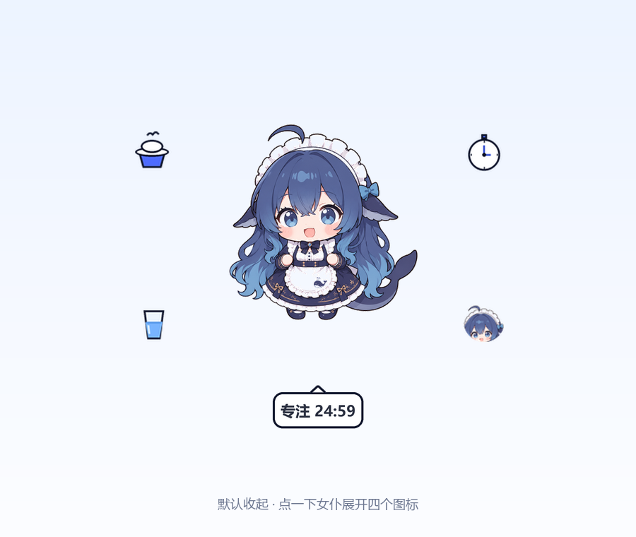
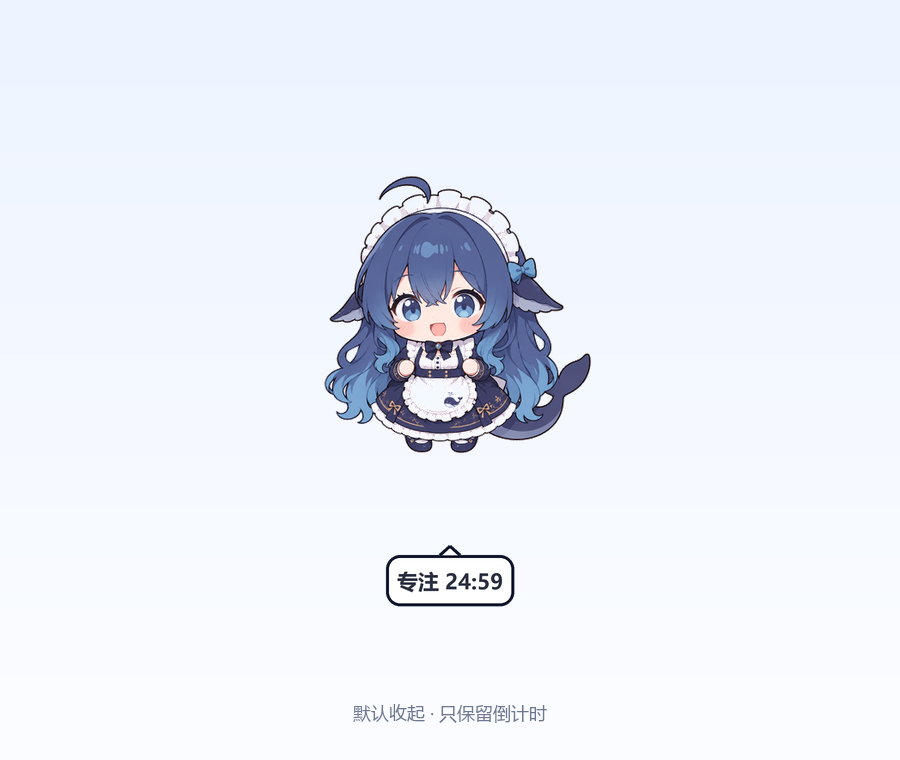

# dsh-pet-plus

给 **蓝毛小女仆（dsh-pet）** 的 DSH 伴生插件：四个可收起的无边框悬浮图标、番茄钟倒计时、喝水提醒。

它不修改 `dsh-pet` 本体，只调用它公开的本地接口；升级 `dsh-pet` 不会覆盖本插件。

## 预览

展开状态（点一下女仆出现四个图标）：



默认收起（只保留番茄钟倒计时）：



## 功能

- **默认全部收起**：四个图标（饭、时钟、水杯、Q 版头像）都不显示；没有番茄钟时画面上什么都不显示。
- **点一下女仆（身体）**：四个无边框图标一起展开，再点一下收起；展开后 **5 秒没有交互会自动收起**。
- **番茄钟**：点时钟选 15 / 25 / 45 / 60 / 90 分钟或自定义；运行时在人物下方显示「专注 24:59」倒计时气泡，点气泡可停止。倒计时 21px、大小随文字自适应，不挡对话框。
- **喂食 / 喝水 / 状态**：只在女仆头顶说一句，不在挂件下方弹反馈气泡。
  - 喂食：饱食 +25
  - 喝水：每 30 / 45 / 60 分钟提醒，或关闭
  - 状态：只报饱食度
- **无边框悬浮**：图标用 Windows 分层窗口逐像素透明，没有卡片、白底或边框；每 1 秒跟随女仆位置。
- **右键菜单**：番茄钟 / 喝水提醒 / 停止番茄钟 / 刷新 / 显示隐藏图标 / 关闭挂件。
- **可重新打开**：关掉后运行 `启动小女仆控制台.bat` 或 `/panel`；设 `DSH_PET_PLUS_PANEL=0` 可关闭自动打开。

## 依赖

- **DSH desktop** 的 `desktop` profile。
- **dsh-pet（蓝毛小女仆）** 已安装；本插件不修改、也不打包它的源码或素材，只调用它的本地接口，并从 `assets/memes/可爱.png` 取头像图标。
- Windows 10/11；挂件使用 DSH 自带的 Python 运行时（Pillow、numpy）。
- 宿主插件需要 Node.js 22+。

## 安装

> `desktop` profile 由 DeepSeek Harness 应用管理，不能直接用 `dsh plugin add`。
> DSH 会监听 profile，通常几秒内热加载；如果命令没出现，再完全退出并重启 DSH。

**方式 A：脚本（推荐）**

在资源管理器里右键 `install.ps1` →「使用 PowerShell 运行」。它会：

1. 把本目录复制到 `%USERPROFILE%\.dsh\profiles\desktop\node_modules\dsh-pet-plus`
2. 在 `%USERPROFILE%\.dsh\profiles\desktop\cordis.patch.yml` 末尾追加一个 `insert` 条目

**方式 B：手动**

1. 把整个 `dsh-pet-plus` 文件夹复制到
   `%USERPROFILE%\.dsh\profiles\desktop\node_modules\dsh-pet-plus`
2. 在 `%USERPROFILE%\.dsh\profiles\desktop\cordis.patch.yml` 末尾追加：

   ```yaml
   - insert:
       - id: dsh-pet-plus
         name: 'dsh-pet-plus'
   ```

3. 重启 DeepSeek Harness。

## 使用

- 点女仆身体：展开 / 收起四个图标（展开后 5 秒无交互会自动收起）。
- 点饭：喂食。
- 点时钟：选番茄钟时长；运行后人物下方出现倒计时。
- 点水杯：选喝水提醒间隔。
- 点头像：让女仆报一次状态。
- 点倒计时气泡：停止番茄钟。
- 右键任意图标或气泡：打开菜单。

## 斜杠命令

| 命令 | 作用 |
|---|---|
| `/feed` | 喂食 |
| `/petstatus` | 饱食度 |
| `/stats` | CPU / 内存 / 电量 |
| `/focus 25` | 番茄钟 25 分钟；`/focus stop` 结束；留空看剩余 |
| `/water 45` | 喝水提醒；`/water off` 关闭 |
| `/progress 3/7 写插件` | 手动显示任务进度（保留命令，不占挂件图标） |
| `/panel` | 打开小女仆控制台 |
| `/petplus` | 用法提示 |

## 不重启也能先用

插件没加载前，可以直接用独立模式驱动正在运行的桌宠：

```powershell
# 端口 = DSH 页面地址的端口（通常在设置里能看到）
node standalone.js --port 64679 --exec "feed"
node standalone.js --port 64679 --exec "focus 25"
node standalone.js --port 64679            # 进入交互模式
```

## 数据与配置

- 状态文件：`%USERPROFILE%\.dsh\dsh-pet-plus\state.json`
  （饱食度、番茄钟结束时间、喝水间隔；删掉即重置）
- 环境变量：
  - `DSH_PET_PLUS_ID`：宠物 id，默认 `main`
  - `DSH_PET_PLUS_SURFACE`：`web` / `desktop` / `both` / `any`，默认 `any`
  - `DSH_HOME`：默认 `%USERPROFILE%\.dsh`
  - `DSH_PET_PLUS_PANEL=0`：不自动打开挂件
  - `DSH_PET_PLUS_AUTOHIDE`：展开后自动收起的秒数，默认 `5`

## 项目结构

```text
dsh-pet-plus/
├─ index.js                 # 宿主插件：命令、状态、HTTP API、面板启动
├─ panel.py                 # 悬浮图标挂件（Tk + Win32 分层窗口）
├─ standalone.js            # 独立模式 CLI
├─ install.ps1 / uninstall.ps1
├─ cordis.patch.yml         # 手动安装用的 insert 片段
├─ 启动小女仆控制台.bat
├─ screenshots/
├─ docs/RELEASE_NOTES_v0.2.0.md
├─ CHANGELOG.md
├─ CONTRIBUTING.md
├─ LICENSE
└─ README.md
```

## 开发与检查

```powershell
node --check index.js
python -m py_compile panel.py
```

挂件单独调试：

```powershell
$env:DSH_HOME = "$env:USERPROFILE\.dsh"
python panel.py
```

## 卸载

1. 删除 `%USERPROFILE%\.dsh\profiles\desktop\node_modules\dsh-pet-plus`
2. 删除 `cordis.patch.yml` 里对应的 `- insert:` 条目
3. 重启 DeepSeek Harness

也可以右键 `uninstall.ps1` 运行。

## 已知限制

- 仅支持 Windows；依赖 Win32 分层窗口和 DSH 自带的 Python。
- 独占全屏游戏/应用可能盖住所有 topmost 窗口。
- 点女仆展开依赖 dsh-pet 的窗口位置；如果女仆被完全挡住，会点不到。
- 这是伴生插件，不修改 `dsh-pet`；如果 `dsh-pet` 升级后改了本地接口，需要跟着更新。
- 倒计时每秒刷新一次；极端情况下会有一秒内的显示延迟。

## License

MIT，见 [LICENSE](LICENSE)。

## Credits

- `dsh-pet` 与蓝毛小女仆的立绘 / 表情包归其原作者所有；本仓库只通过本地接口调用，不打包这些素材。
- 饭、时钟、水杯图标由本项目用 Pillow 绘制；头像图标在运行时从已安装的 `dsh-pet` 素材读取。
